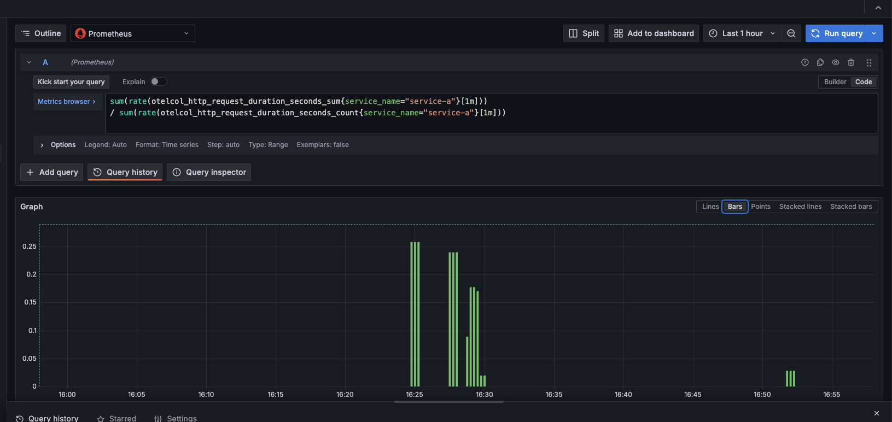

\newpage

# 1. Introducción y sistema objetivo

La ingeniería del caos propone validar la resiliencia de un sistema mediante
experimentos controlados: se inyectan fallos de forma deliberada para comprobar si el
comportamiento real coincide con el esperado. Según los Principios del Caos, el método
parte de una definición de estado estable, formula una hipótesis sobre cómo debería
reaccionar el sistema ante una perturbación y verifica esa hipótesis con métricas
objetivas, manteniendo el radio de impacto acotado y con un mecanismo de reversión
disponible en todo momento.

El sistema objetivo es el pipeline de observabilidad construido en el laboratorio
anterior: dos microservicios (`service-a` y `service-b`) con dependencia HTTP y acceso a
PostgreSQL, instrumentados con OpenTelemetry y observados mediante Jaeger (trazas),
Prometheus y Grafana (métricas) y Loki (logs). Esta instrumentación es lo que permite
verificar cada hipótesis con evidencia y no con suposiciones.

El estado estable se define por los siguientes indicadores de nivel de servicio (SLI),
medidos sobre `service-a`:

- Latencia de respuesta p95 inferior a 50 ms.
- Tasa de error por debajo del 1 %.
- Disponibilidad de respuesta (código 2xx) cercana al 100 %.

# 2. Metodología del Game Day

Un Game Day es un ejercicio planificado en el que el equipo ejecuta experimentos de caos
sobre un entorno controlado, observa el comportamiento y extrae aprendizajes. Las reglas
que gobiernan este ejercicio son:

- Cada experimento parte de una hipótesis previa. El valor está en la predicción, no en
  provocar fallos al azar.
- El radio de impacto se limita a un solo componente por experimento.
- Todo experimento define su duración y su mecanismo de reversión antes de ejecutarse.
- Los experimentos se corren en entorno local o sandbox, nunca en producción sin un plan
  de Game Day y un rollback acordados.

Las plataformas de referencia para orquestar este tipo de experimentos son Chaos Monkey
(terminación aleatoria de instancias), Gremlin (inyección de fallos como servicio, con
latencia, errores y agotamiento de recursos) y Litmus (experimentos de caos sobre
Kubernetes). En el entorno local de este laboratorio los fallos se inyectan con
herramientas equivalentes de más bajo nivel: `tc netem` para latencia de red, `stress-ng`
para saturación de CPU y la detención controlada de contenedores para simular caídas.

\newpage

# 3. Hipótesis de fallo

**H1 — Latencia de red hacia service-b.** En estado estable, cuando `service-b` responde
con 200 ms de latencia de red inyectada, esperamos que la latencia de `service-a` aumente
de forma proporcional pero que el sistema siga respondiendo con código 2xx y sin errores
(degradación controlada), y que las trazas muestren el span `call.service-b.inventory`
como el contribuyente dominante al tiempo total.

**H2 — Indisponibilidad de service-b.** En estado estable, cuando `service-b` deja de
responder, esperamos que `service-a` gestione el fallo de forma controlada —degradando la
respuesta de inventario en lugar de propagar un error en cascada— y que la tasa de error
y los logs correlacionados por `trace_id` permitan localizar con precisión el punto de
fallo.

**H3 — Agotamiento de CPU en service-a.** En estado estable, cuando `service-a` sufre una
saturación de CPU, esperamos que el rendimiento disminuya y la latencia aumente, que el
panel de CPU lo evidencie, y que el limitador de memoria del Collector proteja el pipeline
de telemetría sin interrumpir la recolección de señales.

# 4. Experimentos de caos diseñados

| Exp | Tipo de fallo | Herramienta local (ref. GameDay) | Radio de impacto | Duración | Rollback |
|---|---|---|---|---|---|
| E1 | Latencia de red (+200 ms) | `tc netem` (Gremlin: Latency) | solo service-b | 120 s | automático: `tc qdisc del` |
| E2 | Error / indisponibilidad | detención del contenedor (Chaos Monkey) | solo service-b | 60 s | reinicio del servicio |
| E3 | Agotamiento de CPU | `stress-ng` (Gremlin: CPU; Litmus) | solo service-a | 90 s | fin del proceso (`--timeout`) |

Cada experimento afecta a un único componente para mantener el radio de impacto mínimo.
La reversión de E1 es inmediata al eliminar la disciplina de cola de red; la de E2 se
logra levantando de nuevo el servicio; la de E3 ocurre sola al expirar el temporizador de
`stress-ng`. Los experimentos ejecutados en este laboratorio son E1 y E2; E3 queda
diseñado para una siguiente sesión.

# 5. Métricas de observabilidad para verificar

| Hipótesis | SLI de impacto | Trazas (Jaeger) | Logs (Loki) |
|---|---|---|---|
| H1 | Latencia p95/p99 de service-a | Duración del span `call.service-b.inventory` | Ausencia de líneas con `status=error` |
| H2 | Tasa de error de service-a | Span de la llamada marcado con estado de error | Líneas de error con el `trace_id` del fallo |
| H3 | Rendimiento (req/s) y CPU | Aumento uniforme de la duración de todos los spans | Mensajes de saturación; métricas del Collector |

La correlación por `trace_id` es la pieza que convierte una anomalía en un diagnóstico:
permite pasar de "la latencia subió" a "la latencia subió en el tramo de red hacia
service-b, no en su procesamiento".

\newpage

# 6. Ejecución del experimento E1: latencia de red

## 6.1 Procedimiento

Se inyectó una latencia de 200 ms en la interfaz de red de `service-b` mediante `tc
netem`, aplicada desde un contenedor auxiliar que comparte el espacio de red del servicio,
sin modificar su imagen:

```
docker run --rm --net container:service-b --cap-add NET_ADMIN nicolaka/netshoot \
  tc qdisc add dev eth0 root netem delay 200ms
```

El radio de impacto se limitó a `service-b`. Se midió la latencia de `service-a` con 25
peticiones en tres fases —estado estable, durante el caos y tras la reversión— y se
revirtió el experimento eliminando la disciplina de cola (`tc qdisc del dev eth0 root`).

## 6.2 Resultados obtenidos

| Fase | Latencia promedio | p95 | Máxima | Errores |
|---|---|---|---|---|
| Estado estable | 22.2 ms | 29.3 ms | 41.2 ms | 0 / 25 |
| Durante el caos | 423.2 ms | 429.8 ms | 444.2 ms | 0 / 25 |
| Tras la reversión | 22.5 ms | 38.0 ms | 49.1 ms | 0 / 25 |

> Nota de observabilidad: el pico se visualiza con la latencia promedio
> (`rate(..._sum)/rate(..._count)`) y no con el panel de percentil p99. El histograma
> `http_request_duration_seconds` se instrumento con los limites de bucket por defecto
> (5, 10, 25 s), de modo que todas las latencias reales (0.02 a 0.44 s) caen en el primer
> bucket y el calculo de p99 devuelve un valor constante. Es una limitacion de la
> instrumentacion, no del experimento (ver seccion 7).

{ width=95% }

El desglose de una traza capturada durante el caos confirma dónde se concentró el impacto:

| Span | Servicio | Duración |
|---|---|---|
| GET /order/{order_id} | service-a | 423.6 ms |
| call.service-b.inventory | service-a | 417.5 ms |
| GET (cliente HTTP) | service-a | 404.7 ms |
| fetch.order.db | service-a | 5.6 ms |
| GET /inventory/{product_id} | service-b | 1.2 ms |

## 6.3 Esperado vs. obtenido

La hipótesis H1 se confirma. La latencia de `service-a` creció de 22 ms a 423 ms, pero el
sistema mantuvo el 100 % de respuestas correctas y cero errores: la degradación fue
controlada, tal como se predijo. Las trazas señalan el span `call.service-b.inventory`
como el contribuyente dominante (417 de 423 ms), mientras que el procesamiento interno de
`service-b` se mantuvo en torno a 1 ms. La observabilidad permitió atribuir el impacto al
tramo de red y no al código del servicio, y la reversión devolvió el sistema a su estado
estable de inmediato.

# 7. Ejecución del experimento E2: indisponibilidad de service-b

## 7.1 Procedimiento

Se detuvo el contenedor de `service-b`, simulando una caída total de la dependencia
(equivalente a una terminación de instancia tipo Chaos Monkey):

```
docker compose stop service-b
```

El radio de impacto se limitó a `service-b`. Con el servicio caído se enviaron 10
peticiones a `service-a` y se observaron el código de respuesta, las trazas y los logs. La
reversión consistió en levantar de nuevo el servicio (`docker compose start service-b`).

## 7.2 Resultados obtenidos

| Aspecto | Esperado (H2) | Obtenido |
|---|---|---|
| Respuesta de service-a | 2xx degradado (`available = -1`) | HTTP 500 en 10 de 10 peticiones |
| Manejo del fallo | controlado por `try/except` | excepción no capturada, propagada |
| Excepción observada | `httpx.HTTPStatusError` (manejada) | `httpx.ConnectError` (no manejada) |

En las trazas de Jaeger, los spans `GET /order/{order_id}` y `call.service-b.inventory`
aparecen marcados con estado de error y registran la excepción `httpx.ConnectError`
("Name or service not known"). La traza no contiene spans de `service-b`, lo que confirma
visualmente que el flujo se cortó antes de alcanzarlo. En los logs, `service-a` emite la
traza de error con su `trace_id`, y el panel de tasa de error refleja el 100 % de fallos
durante la ventana del experimento.

## 7.3 Esperado vs. obtenido

La hipótesis H2 se refuta. El manejo de error de `service-a` solo contempla respuestas
HTTP con código de error de `service-b` (`httpx.HTTPStatusError`), pero no el caso en que
`service-b` es inalcanzable, que lanza `httpx.ConnectError`. Esa excepción no se captura,
se propaga y `service-a` responde con 500. En otras palabras, la degradación controlada que
el código parecía garantizar no cubre la indisponibilidad de la dependencia: una caída de
`service-b` se convierte en una caída de `service-a`, sin aislamiento de fallos.

# 8. Reflexión: debilidad sistémica y remediación

El experimento reveló una debilidad latente. Aunque el sistema degradó de forma controlada
ante 200 ms de latencia, `service-a` no cuenta con un cortocircuito (circuit breaker) ni
con un tiempo de espera ajustado para la llamada a `service-b`: el cliente HTTP está
configurado con un timeout de 5 segundos. Bajo una latencia moderada el comportamiento es
aceptable, pero si la latencia de `service-b` se acercara a ese umbral, cada petición
consumiría recursos de `service-a` durante varios segundos, propagando la degradación y
pudiendo agotar la capacidad de atención. Además, `service-a` paga la latencia completa en
cada petición porque no dispone de una caché local de inventario.

El ejercicio tambien expuso una debilidad de la propia observabilidad: el panel de
latencia p99 no refleja el impacto porque el histograma se definio con limites de bucket
inadecuados para la escala de la aplicacion. Sin percentiles fiables, un operador que solo
mirara ese panel no detectaria el evento. Esto refuerza que la instrumentacion debe
dimensionarse a la escala real del servicio.

El segundo experimento revelo la debilidad mas grave: la ausencia de aislamiento de
fallos. `service-a` no distingue entre un error de respuesta de `service-b` y su
indisponibilidad total, por lo que una caida de la dependencia se propaga como una caida
propia. Es un acoplamiento fuerte que contradice el principio de degradacion controlada
que el sistema aparentaba cumplir.

Se proponen las siguientes remediaciones:

- Capturar `httpx.RequestError` (clase padre de `ConnectError` y `TimeoutException`),
  ademas de `HTTPStatusError`, de modo que la indisponibilidad de `service-b` tambien
  degrade de forma controlada en lugar de propagar un error 500.
- Reducir el tiempo de espera de la llamada a `service-b` a un valor alineado con el SLO
  (por ejemplo 1 segundo) y devolver de inmediato la respuesta degradada de inventario
  cuando se exceda, aprovechando el manejo de error que ya existe.
- Incorporar un cortocircuito que, tras una racha de llamadas lentas o fallidas, deje de
  invocar a `service-b` temporalmente y responda con el valor degradado, evitando el
  consumo de recursos en espera.
- Añadir una caché de inventario en `service-a` con un tiempo de vida corto, para no pagar
  la latencia completa en cada petición.
- Redefinir los limites de bucket del histograma de latencia a la escala real del
  servicio (por ejemplo 5, 10, 25, 50, 100, 250, 500 y 1000 ms) para que el calculo de
  percentiles sea fiable.
- Definir una alerta sobre la latencia p99 en Grafana, de modo que un evento de este tipo
  se detecte antes de que afecte a los usuarios.

# 9. Conclusiones

El Game Day cumplió su propósito con dos experimentos ejecutados: uno confirmó la
hipótesis (H1, degradación controlada ante latencia) y otro la refutó (H2, la
indisponibilidad de la dependencia no se maneja y provoca un fallo 500 en cascada). Un
resultado que refuta la hipótesis es tan valioso como uno que la confirma: expuso un
acoplamiento de fallos que de otro modo habría permanecido oculto hasta un incidente real.
Cada experimento partió de una hipótesis previa, un alcance acotado y
reversible, y una verificación basada en métricas reales. El sistema demostró degradación
controlada ante la latencia, y la observabilidad construida permitió localizar la causa
con precisión. El ejercicio también expuso una debilidad concreta —la ausencia de
cortocircuito y de un tiempo de espera ajustado— con una ruta de remediación clara.

Como recomendación de seguridad, estos experimentos solo deben ejecutarse en entornos
controlados y con un plan de reversión definido de antemano. El valor de la práctica
reside en la hipótesis y en lo que se aprende al contrastarla, no en provocar fallos de
forma indiscriminada.
