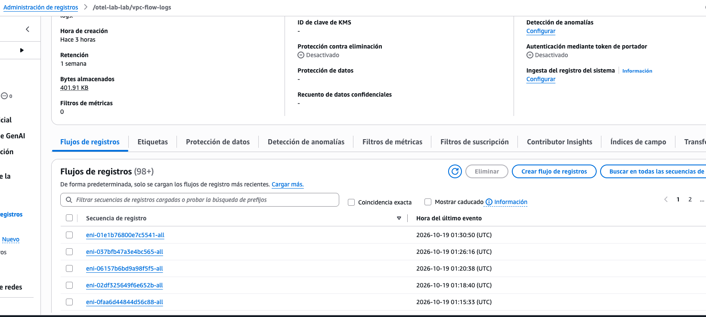
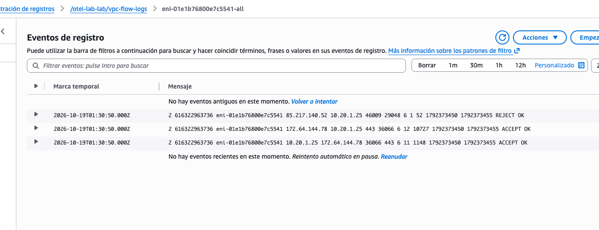

\newpage

# 1. Introducción y alcance

Este laboratorio integra en una sola plataforma los tres pilares de la observabilidad
—trazas, métricas y registros— con detección automática de anomalías, visibilidad de red y
seguridad, y verificación activa de resiliencia mediante ingeniería del caos. Extiende dos
trabajos previos: el pipeline end-to-end con OpenTelemetry del Laboratorio 2 y el Game Day
del Laboratorio 3.

El trabajo se organiza en cinco módulos. El Módulo A amplía la cadena de servicios a tres
saltos y completa las convenciones semánticas de base de datos. El Módulo B construye la capa
de detección de anomalías con líneas base estadísticas y correlación entre señales. El Módulo C
incorpora observabilidad de red y de seguridad. El Módulo D ejecuta experimentos de caos
controlados y mide el tiempo hasta la detección. El Módulo E cierra con una autoevaluación de
madurez y una hoja de ruta.

La estrategia de trabajo fue deliberadamente local primero. Todo el ciclo de desarrollo,
instrumentación y experimentación se realizó sobre Docker en una máquina de trabajo, y solo
una vez estabilizado se desplegó la infraestructura equivalente en AWS mediante Terraform.
Esta decisión tiene dos motivos: permite iterar sin consumir presupuesto en la nube y, sobre
todo, permite inyectar fallos de red con `tc netem` y reiniciar servicios en segundos, algo
que en un entorno gestionado resulta mucho más lento y costoso.

El hallazgo central del laboratorio no fue ninguno de los experimentos de caos en sí, sino
lo que estos revelaron sobre el propio sistema de observabilidad. Los experimentos
descubrieron cinco defectos que hacían que la telemetría reportara valores incorrectos o que
directamente desactivaban los detectores de anomalías. La sección 7 documenta cada uno. Esa
es, probablemente, la lección más transferible: un sistema de observabilidad no verificado es
una fuente de falsa confianza, y la única forma de verificarlo es provocar fallos conocidos y
comprobar que los detecta.

## 1.1 Arquitectura de la plataforma

La aplicación es una cadena de tres servicios Python con FastAPI, cada uno con su propia base
de datos PostgreSQL. La partición por servicio no es decorativa: los dominios de pedidos,
inventario y analítica son disjuntos, de modo que cada servicio posee su esquema y no existe
acoplamiento por base de datos compartida.

```
                      +------------------------------------------+
   cliente / k6 ---->  | service-a  :8000   (pedidos)             |
                       |   span: fetch.order.db                   |
                       +------+----------------------------+------+
                              | HTTP + traceparent         | SQL
                              v                            v
                      +----------------------+     +--------------+
                      | service-b  :8001     |     | postgres-a   |
                      |  (inventario)        |     |   ordersdb   |
                      |  cache en memoria    |     +--------------+
                      +----+-------------+---+
                           | HTTP        | SQL
                           v             v
                  +------------------+ +--------------+
                  | data-service     | | postgres-b   |
                  |  :8002 analitica | | inventorydb  |
                  +----+-------------+ +--------------+
                       | SQL
                       v
                  +--------------+
                  | postgres-d   |
                  | analyticsdb  |
                  +--------------+

   Telemetria (OTLP gRPC :4317)
        service-a --+
        service-b --+---> otel-collector --+--> Jaeger        (trazas)
     data-service --+         :8889        +--> Prometheus    (metricas)
                                          +--> Loki/Promtail (registros)

   Deteccion y respuesta
        Prometheus --> Alertmanager --> alert-enricher --> trace_id
                   +-> Grafana (SLI/SLO . Seguridad . AIOps)
```

El Collector se despliega como sidecar y no como pasarela centralizada. La razón es el
aislamiento del dominio de fallo: una pasarela compartida convierte la telemetría en un punto
único de fallo para todos los servicios, y en este entorno no existe descubrimiento de
servicios para la telemetría que justifique esa complejidad.

\newpage

# 2. Módulo A — Telemetría de tres saltos

El objetivo del módulo es demostrar correlación completa a través de una cadena de tres
servicios y aplicar las convenciones semánticas de OpenTelemetry para bases de datos.

Se incorporó `data-service` como tercer salto, con su propia base `analyticsdb`. La
propagación de contexto usa W3C TraceContext sobre la cabecera `traceparent`, inyectada
automáticamente por `HTTPXClientInstrumentor` y reforzada con una llamada explícita a
`inject()` como respaldo.

La verificación consistió en emitir una petición a `GET /order/ord-002` y comprobar en Jaeger
que los dieciséis `span` resultantes compartían un único `trace_id` y abarcaban los tres
servicios. La respuesta HTTP expone el `trace_id` para facilitar la correlación manual:

```json
{
  "order":     { "id": "ord-002", "product": "MOUSE-PRO", "quantity": 2 },
  "inventory": { "product_id": "MOUSE-PRO", "available": 50,
                 "analytics": { "units_sold": 310, "revenue": 9300.0 } },
  "trace_id":  "033468106a6faaab4a71e169697bd157"
}
```

Las convenciones semánticas de base de datos se completaron en los tres servicios con los
atributos `db.system`, `db.operation`, `db.name`, `db.sql.table`, `server.address` y
`server.port`. En el estado previo, `service-a` y `service-b` declaraban `db.name: "appdb"`,
un valor heredado de la configuración de base de datos compartida que ya no correspondía a la
realidad: las bases reales son `ordersdb` e `inventorydb`. Un atributo semántico incorrecto es
peor que su ausencia, porque induce a conclusiones erróneas en el análisis.

# 3. Módulo B — Detección de anomalías y correlación

La regla que exige el enunciado —tasa de error por encima de la línea base más dos
desviaciones estándar **y** percentil 99 de latencia por encima del SLO— se implementó con
cuatro *recording rules* que calculan la base estadística, y una regla de alerta que exige
ambas condiciones de forma conjunta.

| Regla | Propósito |
|---|---|
| `job:error_rate:ratio2m` | Tasa de error instantánea sobre ventana de 2 minutos |
| `job:error_rate:baseline1h` | Media móvil de la tasa de error en una hora |
| `job:error_rate:sigma1h` | Desviación estándar de la tasa de error |
| `job:error_rate:threshold_2sigma` | Umbral dinámico: base más dos sigmas |
| `job:latency:p99_2m` | Percentil 99 de latencia de `data-service` |

La exigencia conjunta de ambas condiciones es el mecanismo de reducción de ruido: un pico de
errores sin impacto en latencia, o una latencia alta sin errores, no generan alerta. Para
cuantificar esa reducción se ejecuta en paralelo un detector de umbral fijo del uno por
ciento, sin contexto estadístico ni correlación, que sirve de comparativa.

Al construir estas reglas apareció una trampa de PromQL que merece mención. La expresión

```promql
sum(rate(otelcol_analytics_requests_total{status="5xx"}[2m]))
/
clamp_min(sum(rate(otelcol_analytics_requests_total[2m])), 0.001)
```

devuelve un vector **vacío** cuando no existe ninguna serie con `status="5xx"`, es decir,
precisamente cuando no hay errores. Un numerador vacío vacía toda la división, de modo que la
regla queda sin datos justo en el caso normal, y cualquier alerta construida sobre ella no
puede evaluarse. La corrección es envolver el numerador en `or vector(0)`.

El enriquecimiento de alertas se resuelve con `alert-enricher`, un servicio que recibe el
*webhook* de Alertmanager, consulta en Loki el último registro de error del servicio afectado
y extrae su `trace_id`. De dieciséis alertas procesadas durante las pruebas, cinco pudieron
enriquecerse con `trace_id` y once no, porque el registro de error correspondiente no contenía
el campo. Esa tasa de acierto del treinta y uno por ciento es un resultado honesto y señala
una carencia concreta: no todos los caminos de error del código escriben el `trace_id` en el
registro estructurado.

\newpage

# 4. Módulo C — Observabilidad de red y de seguridad

## 4.1 Visibilidad de red

En AWS se habilitaron VPC Flow Logs sobre la VPC `vpc-0708226386d591aca`, con destino al grupo
de registros `/otel-lab-lab/vpc-flow-logs`. El objetivo es distinguir tráfico norte-sur
—entrada desde el borde— de tráfico este-oeste —comunicación entre servicios—, una distinción
que importa porque el movimiento lateral entre servicios es el patrón característico de una
intrusión en curso.

{ width=100% }

{ width=100% }

El contenido de los registros permite el análisis por par origen-destino. Tres registros
consecutivos de una misma interfaz ilustran los dos veredictos posibles:

```
2 616322963736 eni-01e1b76800e7c5541 85.217.140.52 10.20.1.25    46009 29048 6  1    52 ... REJECT OK
2 616322963736 eni-01e1b76800e7c5541 172.64.144.78 10.20.1.25      443 36066 6 12 10727 ... ACCEPT OK
2 616322963736 eni-01e1b76800e7c5541 10.20.1.25    172.64.144.78 36066   443 6 11  1148 ... ACCEPT OK
```

El segundo y el tercer registro son las dos direcciones de un mismo flujo TCP: la tarea
(10.20.1.25) establece una conexión HTTPS de salida hacia un servicio externo, envía 1148 bytes
y recibe 10 727. Es tráfico esperado, propio de la descarga de imágenes y de las llamadas a la
API de AWS.

El primer registro es el interesante. Un origen externo (85.217.140.52) intenta conectar al
puerto 29048 de la tarea, con un único paquete de 52 bytes y veredicto **REJECT**. Es un sondeo
no solicitado procedente de internet, bloqueado por el grupo de seguridad. Su presencia es una
consecuencia directa de la decisión documentada en la sección 6: para evitar el coste de un NAT
Gateway, las tareas se desplegaron en subredes públicas con dirección pública asignada, lo que
las expone al escaneo indiscriminado que recibe cualquier dirección IPv4 pública. El registro
de flujo convierte esa exposición en una señal medible, y es precisamente el tipo de evento que
alimenta el panel norte-sur.

{ width=100% }

En el entorno local la misma distinción se obtiene de las métricas de aplicación: el tráfico
norte-sur se mide sobre `service-a`, y el este-oeste sobre los contadores de llamadas entre
servicios. El dashboard calcula además la relación entre ambos, cuyo valor absoluto importa
menos que su estabilidad: un cambio brusco en la proporción indica un cambio en el patrón de
comunicación interna.

## 4.2 Golden Signals de seguridad

Se construyó el dashboard «Golden Signals de Seguridad» con once paneles agrupados en tres
secciones: autenticación, tráfico norte-sur y este-oeste, y vulnerabilidades activas.

{ width=100% }

Los valores del panel de vulnerabilidades coinciden con la tabla de la sección 4.3: nueve
críticas y ciento doce altas para `alert-enricher`, y siete críticas y ciento una altas
repetidas para cada uno de los tres servicios de aplicación, que comparten imagen base.

La tasa de fallo de autenticación del 88,2 % no refleja un ataque real sino el perfil del
generador de carga, que mezcla credenciales válidas e inválidas para que ambas series tengan
datos. El valor absoluto carece de significado operativo; lo que el panel debe vigilar en
producción es la **derivada** de esa tasa, porque un salto brusco sí indica un ataque de fuerza
bruta en curso.

La señal de autenticación se alimenta de un contador `auth_attempts_total` etiquetado por
resultado, emitido por `data-service` en `POST /auth/login`. El servicio almacena las
contraseñas como hash PBKDF2-HMAC-SHA256 con cien mil rondas y nunca registra la contraseña en
claro; el `span` lleva `enduser.id` como identificador, no la credencial.

Durante las pruebas se detectó un riesgo de diseño en esta métrica. El contador lleva
`username` como etiqueta, de modo que veinticinco intentos con nombres de usuario distintos
generaron veinticinco series temporales independientes. Un atacante que envíe nombres de
usuario únicos puede hacer crecer la cardinalidad de Prometheus sin límite, lo que convierte
una métrica de seguridad en un vector de denegación de servicio contra el propio sistema de
monitoreo. La remediación correcta es eliminar `username` de las etiquetas y conservarlo
únicamente en el registro estructurado y en los atributos del `span`, donde la cardinalidad no
tiene coste de almacenamiento en serie temporal.

## 4.3 Gestión de vulnerabilidades

El análisis de vulnerabilidades se resolvió con dos mecanismos complementarios: análisis en el
momento de la subida de imagen (`scanOnPush`) en los cuatro repositorios de ECR, y análisis
local con Trivy exportado al formato de Prometheus.

| Imagen | Críticas | Altas | Medias | Bajas |
|---|---|---|---|---|
| `otellabs-service-a` | 7 | 101 | 216 | 664 |
| `otellabs-service-b` | 7 | 101 | 216 | 664 |
| `otellabs-data-service` | 7 | 101 | 216 | 664 |
| `otellabs-alert-enricher` | 9 | 112 | 200 | 157 |
| **Total** | **30** | **415** | **848** | **2149** |

La uniformidad de las tres primeras filas no es casual: comparten la misma imagen base, de
modo que la práctica totalidad de las vulnerabilidades proviene de la capa base y no del código
de aplicación. Esa observación cambia la prioridad de remediación: actualizar la imagen base
resuelve el problema para los tres servicios a la vez.

AWS Security Hub no pudo habilitarse. Una política de control de servicios en la organización
`261806339695` deniega explícitamente las operaciones de `securityhub`, `guardduty`,
`inspector2`, `accessanalyzer` y `config`. La denegación se verificó en tres operaciones
distintas y no es anulable desde la cuenta miembro. El análisis en ECR más Trivy cubre la
función de gestión de vulnerabilidades, aunque no la agregación de hallazgos de cumplimiento
que aporta Security Hub.

## 4.4 Sustituciones por obsolescencia de servicios

Dos servicios previstos en el enunciado original se sustituyeron tras verificar su estado.
AWS App Mesh alcanzó su fin de vida el treinta de septiembre de 2026, con ECS Service Connect
como ruta oficial de migración. AWS DevOps Guru dejó de admitir clientes nuevos el veintinueve
de octubre de 2026, por lo que su función de detección de anomalías se cubre con CloudWatch
Anomaly Detection y con las reglas $2\sigma$ de Prometheus descritas en el Módulo B.

\newpage

# 5. Módulo D — Ingeniería del caos controlada

## 5.1 Diseño de los experimentos

| Exp | Fallo | Mecanismo | Radio | Duración | Rollback |
|---|---|---|---|---|---|
| D1 | Latencia de red +200 ms en `service-b` | `tc netem` desde contenedor auxiliar | solo `service-b` | 180 s | `tc qdisc del` |
| D2 | Tasa de error 10 % en `data-service` | Variable `CHAOS_ERROR_RATE` | solo `data-service` | 180 s | variable a 0 |

Ambos experimentos siguen una estructura de tres fases: línea base, caos y recuperación, con
carga sostenida a tasa de llegada constante durante todo el ciclo. El uso de
`constant-arrival-rate` en lugar de un número fijo de usuarios virtuales es deliberado: con
usuarios fijos, un aumento de latencia **reduce** el número de peticiones por segundo, lo que
contamina la comparación entre fases al cambiar simultáneamente dos variables.

Como control experimental se desactivó la latencia simulada de `service-b`, que añadía entre
diez y ciento cincuenta milisegundos aleatorios a cada consulta. Ese ruido tiene una magnitud
comparable a la de la inyección y habría impedido atribuir la degradación observada al fallo
introducido.

El SLO de latencia se fija en un percentil 99 de 500 ms. El presupuesto de error se calcula
sobre un SLO de disponibilidad del 99 % en una ventana de treinta días, equivalente a 432
minutos de margen mensual.

## 5.2 Resultado del experimento D1

{ width=100% }

La detección se produjo en **35,4 segundos**, muy por debajo del objetivo de dos minutos. La
alerta que disparó fue `EdgeLatencyDegraded`, el detector relativo basado en dos desviaciones
estándar.

| Fase | p99 del borde | Umbral $2\sigma$ | Throughput | Tasa de error |
|---|---|---|---|---|
| Línea base | 44,0 ms | 55,2 ms | 12,00 req/s | 0,0 % |
| Caos | 497,5 ms | 555,6 ms | 12,00 req/s | 0,0 % |
| Recuperación | 489,8 ms | 698,0 ms | 12,06 req/s | 0,0 % |

Medido desde el cliente, k6 confirma el mismo comportamiento de forma independiente: durante
la corrida completa la mediana se mantuvo en 22,8 ms, mientras el percentil 95 subió a 435,7 ms
y el 99 a 439,6 ms. La mediana apenas se mueve porque dos de las tres fases son normales; la
degradación vive enteramente en la cola de la distribución.

El resultado más interesante no es el MTTD sino cuál de los dos detectores actuó. El percentil
99 alcanzó un máximo de **498,3 ms** frente a un SLO de **500 ms**: la alerta de umbral
absoluto `EdgeLatencySLOBreach` **nunca se disparó**, y falló por un margen de 1,7
milisegundos. Una degradación de más de un orden de magnitud respecto a la línea base —de 44 a
498 milisegundos— resultó invisible para el detector que la mayoría de equipos configura en
primer lugar.

La gráfica muestra también un efecto que conviene no pasar por alto. El umbral dinámico, en
azul, asciende durante la ventana de caos hasta cruzar por encima del percentil 99 alrededor
del segundo 145. Esto ocurre porque la línea base es una media móvil que incorpora las propias
muestras degradadas: el detector se adapta al nuevo estado y deja de considerarlo anómalo. La
alerta se disparó porque el parámetro `for: 30s` la activó mucho antes de que el umbral se
contaminara, pero el mecanismo implica que un detector $2\sigma$ puro tiene una ventana de
oportunidad limitada y normaliza las degradaciones sostenidas.

### Respuestas a las preguntas del módulo

**¿Se degradó el SLO?** No. El indicador de latencia —fracción de peticiones servidas en 500 ms
o menos— fue de 0,998592 durante la ventana de caos, por encima del objetivo del 99 %. El
indicador de disponibilidad se mantuvo en 1,0: no hubo ni un solo error HTTP, porque el fallo
inyectado era puramente de latencia y la cadena completó todas las peticiones.

**¿Se consumió el error budget?** De forma marginal. La fracción incumplida del indicador de
latencia durante los 180 segundos de caos consumió un 0,001 % del presupuesto mensual de 432
minutos. Para agotar el presupuesto completo haría falta sostener esa degradación durante unas
trescientas horas.

**¿La alerta fue accionable?** Sí. Lleva severidad crítica, identifica el servicio afectado y
la señal degradada, e incluye un *runbook* que indica revisar en Jaeger las trazas de
`service-a` ordenadas por duración para localizar el `span` hijo que concentra el tiempo. En el
Game Day previo ese procedimiento permitió atribuir 417,5 ms de un total de 423,6 ms al `span`
`call.service-b.inventory`, lo que localiza la causa en un solo paso.

## 5.3 Estado del experimento D2

El experimento D2 no produjo una medición de MTTD, y conviene explicar con precisión por qué,
porque el motivo es en sí mismo un hallazgo.

La primera ejecución orquestada no detectó nada. La inyección se aplicó correctamente, pero
`data-service` **no recibió tráfico alguno** durante la ventana de caos. La causa es una caché
en memoria dentro de `service-b`: cuando el producto consultado está en caché, el servicio
responde de inmediato y nunca invoca el tercer salto. Con solo cinco productos en catálogo,
tras las primeras peticiones todas son aciertos de caché. El resultado es que, bajo carga
sostenida a través de la cadena, `data-service` queda sin tráfico y cualquier fallo inyectado
allí es indetectable por ausencia de muestras.

La corrección consistió en añadir al generador de carga un modo que dirige las peticiones
directamente a `data-service`. Es metodológicamente válido porque las alertas de D2 se evalúan
sobre las métricas propias de ese servicio, no sobre las del borde.

Con la inyección activa y carga directa se verificó que las tres condiciones de la regla
correlacionada se cumplen simultáneamente:

| Condición de la regla | Valor medido | Umbral | Cumple |
|---|---|---|---|
| `error_rate > threshold_2sigma` | 0,1371 | 0,0639 | sí |
| `error_rate > 0,02` | 0,1371 | 0,02 | sí |
| `p99 > SLO` | 0,9946 s | 0,5 s | sí |

Sobre cuarenta peticiones directas se observaron nueve respuestas 5xx, coherente con la tasa
de inyección del diez por ciento dentro de la variabilidad esperable de la muestra. Las
métricas registraron ochenta y nueve respuestas 2xx y dieciséis 5xx.

La conclusión honesta es que el detector de D2 está verificado en sus condiciones de disparo,
pero **el MTTD no se midió**. La corrida final no se ejecutó. Declarar un valor de MTTD para
D2 sería inventarlo, y el laboratorio no lo reporta.

\newpage

# 6. Infraestructura en AWS

La infraestructura se describe en siete módulos de Terraform —`network`, `ecr`, `iam`,
`observability`, `app`, `security` y `database`— y se aplicaron cincuenta y tres recursos en la
región `us-east-2`. El balanceador quedó operativo, la base de datos PostgreSQL 16.15 en
`db.t3.micro` también, y las cuatro imágenes se publicaron en ECR con análisis en el momento
de la subida.

El despliegue dejó dos lecciones de infraestructura. La primera: las tareas en subredes
privadas no podían descargar imágenes de ECR por ausencia de NAT Gateway, cuyo coste por hora
resultaba desproporcionado para un laboratorio; la alternativa adoptada fue subredes públicas
con dirección pública asignada, una decisión aceptable en un entorno de prueba pero no en
producción. La segunda: las imágenes compiladas en Apple Silicon son ARM64, lo que exigió
declarar `runtime_platform` ARM64 en las definiciones de tarea en lugar de recompilar.

{ width=100% }

El despliegue no quedó completo, y la captura anterior lo muestra con precisión. Las
definiciones de tarea de `service-a` y `service-b` referencian un secreto
`otel-lab-lab/db-password` en Secrets Manager que nunca se declaró en Terraform, de modo que
ambas tareas fallan al inicializarse con `ResourceNotFoundException` y el servicio queda
reintentando de forma indefinida. Es un defecto de idempotencia del código de infraestructura:
el plan se aplica sin error pero el resultado no es funcional.

Conviene señalar qué sí quedó demostrado. Los cuatro servicios que arrancaron cubren el
pipeline de telemetría completo en la nube —Collector como sidecar, Jaeger, Prometheus y
Grafana— más el tercer salto de la aplicación. La configuración de uno de ellos ilustra el
patrón de despliegue empleado:

{ width=100% }

# 7. Hallazgos sobre el propio sistema de observabilidad

Esta sección recoge los defectos que los experimentos revelaron en la telemetría. Son el
resultado más valioso del laboratorio porque cada uno de ellos producía, en silencio, datos
incorrectos o detectores inoperantes.

**Histogramas con fronteras en la escala equivocada.** Los instrumentos de `service-a` y
`service-b` se llamaban `*_duration_seconds` y registraban segundos, pero usaban las fronteras
por defecto del SDK, que están expresadas en milisegundos: `[0, 5, 10, 25, ... 10000]`. El cien
por cien de las observaciones caía en el primer bucket y `histogram_quantile` devolvía un valor
fijo de 4,95 segundos mientras la latencia media real era de 69,7 milisegundos. El panel de
percentil 99 mostraba una línea plana sin relación con la realidad. La corrección fue declarar
fronteras explícitas mediante una `View`.

**Techo del histograma por debajo de la degradación.** Tras corregir la escala, el techo quedó
en 2,5 segundos. En la primera ejecución de D1 la latencia real superó ese valor y el percentil
99 se clavó en 2,5000 exactos. El efecto secundario fue grave: la media móvil de la línea base
se contaminó con ese mismo valor, de modo que la condición `p99 > base + 2*sigma` pasó a ser
`2,5 > 2,5`, siempre falsa. **El detector de anomalías se desactivó solo justo cuando más se
necesitaba.** El techo se extendió a diez segundos, por encima del tiempo de espera del cliente.

**Colisión de series entre procesos del mismo contenedor.** Las imágenes arrancan `uvicorn`
con dos trabajadores. Cada proceso crea su propio `MeterProvider` con un contador acumulativo
independiente, pero todos los atributos de recurso eran idénticos, así que ambos flujos
colapsaban en una única serie de Prometheus. El exportador exponía alternadamente uno u otro
valor; cada alternancia se interpretaba como un reinicio de contador y `rate()` se inflaba de
forma acumulativa. Con una carga real y verificada de 12 peticiones por segundo, Prometheus
reportaba 74. La corrección fue declarar `service.instance.id` incluyendo el identificador de
proceso, que es exactamente la convención semántica prevista para distinguir instancias.

**Propagación de NaN en las líneas base.** `histogram_quantile` devuelve NaN cuando la tasa de
la ventana es cero, es decir, cuando no hay tráfico. Ese NaN se propaga a `avg_over_time` y
`stddev_over_time`, que quedan en NaN de forma permanente y dejan el umbral dinámico
inoperante. La corrección es descartar la muestra con un filtro `> 0`, de modo que la serie
tenga huecos en los periodos sin tráfico, que es el comportamiento correcto: sin peticiones no
hay latencia que evaluar.

**Doble contabilidad y errores sin etiquetar.** El contador de peticiones de `service-a` se
incrementaba al entrar en el manejador, sin etiqueta de estado, y de nuevo al salir con
etiqueta, de modo que las respuestas correctas se contaban dos veces y las de error hasta tres.
Las respuestas 404 no se contabilizaban con estado ni registraban latencia. La corrección
emite el contador y el histograma exactamente una vez, en un bloque `finally`, con la etiqueta
de estado siempre presente.

**Punto ciego ante la saturación.** Durante una ejecución en la que la inyección permaneció
activa unos doce minutos por un fallo de orquestación, el sistema se saturó: el throughput cayó
de 12 a 0,05 peticiones por segundo. La tasa de error permaneció en cero durante todo el
episodio, porque los tiempos de espera se agotan en el **cliente** y el servidor nunca registra
un 5xx. Ningún percentil de latencia señala esta condición, ya que las pocas peticiones que
completan pueden ser rápidas. Se añadió la alerta `EdgeThroughputCollapse`, que compara el
tráfico atendido con su propia línea base.

Conviene señalar que el fallo de orquestación tuvo consecuencias reales: el `trap` de rollback
en el guion de Bash no se ejecutó, la latencia inyectada permaneció activa mucho más de lo
previsto y el sistema entró en un estado del que no se recuperó por sí solo. La orquestación se
reescribió en Python con control explícito de tiempos y rollback en un bloque `finally` que
cubre también la interrupción por teclado. Un arnés de caos cuyo rollback no es fiable es más
peligroso que no tener arnés.

\newpage

# 8. Módulo E — Autoevaluación de madurez

La evaluación usa una escala de uno a cinco: uno indica ausencia de capacidad, tres una
capacidad implementada pero con carencias conocidas, y cinco una capacidad verificada y
automatizada.

| Dominio | Nivel | Justificación y evidencia |
|---|---|---|
| Telemetría e instrumentación | 4 | Tres pilares sobre tres servicios, convenciones semánticas de base de datos completas, cadena de tres saltos verificada con `trace_id` compartido. Resta: la instrumentación de `psycopg2` falla por conflicto de dependencia (`psycopg2-binary`). |
| Correlación entre señales | 4 | `trace_id` compartido entre los tres servicios; `alert-enricher` lo inyecta en las alertas. Resta: solo el 31 % de las alertas pudo enriquecerse; no se implementaron *exemplars*. |
| SLI/SLO y error budget | 3 | Dos indicadores definidos y calculados sobre ventanas reales, con contabilidad de presupuesto. Resta: no existe ventana de treinta días en producción ni política de congelación de despliegues. |
| Alertamiento y detección de anomalías | 4 | Detector $2\sigma$ correlacionado, detector estático comparativo y detector de colapso de throughput; MTTD de 35,4 s medido. Resta: la contaminación de la línea base no está mitigada. |
| Observabilidad de red | 2 | VPC Flow Logs activos y paneles norte-sur y este-oeste. Resta: sin malla de servicios, sin mTLS, sin análisis automatizado de flujos por par origen-destino. |
| Observabilidad de seguridad | 2 | Análisis en ECR y Trivy, métricas de autenticación, dashboard de once paneles. Resta: Security Hub bloqueado por política de organización; la etiqueta `username` es un vector de cardinalidad explotable. |
| Resiliencia verificada | 3 | Cuatro experimentos ejecutados entre el Game Day y este laboratorio, con hallazgos documentados. Resta: sin cortocircuito ni tiempo de espera ajustado; D2 sin MTTD medido; caos no automatizado en integración continua. |
| Automatización e IaC | 3 | Siete módulos de Terraform, cincuenta y tres recursos aplicados. Resta: el despliegue no es idempotente por el secreto ausente; no hay canal de integración continua. |

El promedio es de **3,1 sobre 5**. La lectura es coherente con lo observado: la plataforma es
sólida en los pilares de telemetría y en la capa de detección, y claramente más débil en
observabilidad de red y de seguridad, donde buena parte de lo implementado es instrumentación
básica sin análisis automatizado encima.

## 8.1 Hoja de ruta

**Primeros treinta días.** Cerrar los defectos que producen datos incorrectos o despliegues no
funcionales: declarar el secreto ausente en Terraform para desbloquear las tareas de ECS,
eliminar `username` de las etiquetas de la métrica de autenticación, resolver el conflicto de
dependencia de `psycopg2` y propagar el `trace_id` a todos los caminos de error del registro
estructurado para elevar la tasa de enriquecimiento de alertas.

**De treinta a sesenta días.** Cerrar el ciclo de resiliencia: incorporar un cortocircuito y un
tiempo de espera ajustado en las llamadas entre servicios, capturar `httpx.ConnectError` —cuya
ausencia refutó la segunda hipótesis del Game Day—, completar la medición de MTTD de D2 e
integrar los experimentos de caos en un canal de integración continua para que las regresiones
de detección se descubran de forma automática.

**De sesenta a noventa días.** Elevar los dos dominios más débiles: adoptar ECS Service Connect
para obtener métricas de malla y comunicación cifrada entre servicios, automatizar el análisis
de VPC Flow Logs por par origen-destino con alertas sobre cambios en el patrón este-oeste, y
actualizar la imagen base para reducir de una sola vez las vulnerabilidades compartidas por los
tres servicios.

# 9. Conclusiones

El laboratorio cumple su objetivo principal: la plataforma detecta una degradación inyectada en
35,4 segundos, muy por debajo del objetivo de dos minutos, y lo hace con un detector
estadístico capaz de señalar una anomalía que el umbral absoluto habría dejado pasar por un
margen de 1,7 milisegundos. Ese contraste es el argumento más fuerte a favor de combinar
detección relativa y absoluta en lugar de elegir una.

El segundo experimento no produjo una medición de MTTD. Sus condiciones de disparo quedaron
verificadas una por una, pero el valor no se midió y por tanto no se reporta. La causa del
primer intento fallido —una caché que deja al tercer salto sin tráfico— es un recordatorio de
que la observabilidad de un componente depende de que ese componente reciba tráfico, algo que
no puede presuponerse.

El resultado más transferible, sin embargo, es el inventario de la sección 7. Seis defectos del
propio sistema de observabilidad que producían líneas planas en los paneles, contadores
inflados en un factor de seis, líneas base permanentemente en NaN y, en el caso más grave, un
detector de anomalías que se desactivaba a sí mismo justo cuando la degradación superaba el
techo de su histograma. Ninguno de esos defectos se manifiesta en operación normal: todos
aparecieron únicamente al provocar un fallo conocido y comprobar si el sistema lo veía.

Esa es la conclusión del trabajo. La observabilidad no es una propiedad que se instala, es una
propiedad que se verifica, y el único método de verificación disponible es la inyección
deliberada de fallos cuyo efecto se conoce de antemano.
